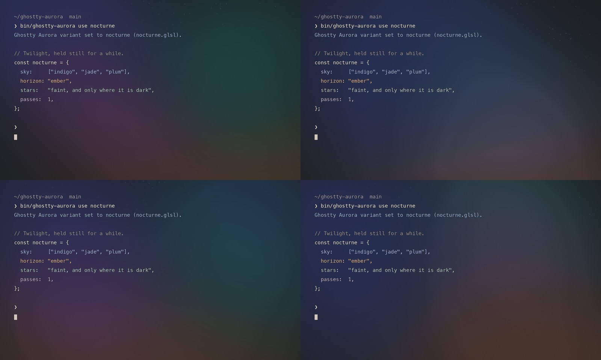

# Nocturne

Nocturne is an MIT-licensed Ghostty shader that paints a slow twilight sky
behind terminal text: drifting pools of indigo, jade, and plum light, a warm
ember glow rising from below the frame, and faint stars that only appear where
the sky is dark. Nocturne Lite uses three pools and no stars. Both are
standalone GLSL files that need only `iChannel0`, `iResolution`, and `iTime`,
and both leave the terminal's alpha and bright or saturated text intact.



## Use

```sh
bin/ghostty-aurora use nocturne
bin/ghostty-aurora use nocturne-lite
bin/ghostty-aurora use nocturne --intensity 0.6
```

Include `config/ghostty-aurora.conf` in your Ghostty config, then reload the
config. Direct installation also works:

```conf
custom-shader = /absolute/path/to/nocturne.glsl
custom-shader-animation = true
```

Do not use both installation methods at once: repeated `custom-shader` entries
stack passes.

## Tuning

Durable edits belong in `src/nocturne.template.glsl` and `src/variants.mjs`;
regenerate with `node scripts/build-variants.mjs`.

| Constant | What it does |
| --- | --- |
| `AURORA_INTENSITY` | Overall strength. Kept under this name so the switcher's `--intensity` and `intensity set` work. |
| `NOCTURNE_SPEED` | Drift speed. Pools take roughly a minute and a half to wander across; the edge warp moves faster. |
| `NOCTURNE_POOLS` | `3` (indigo, jade, ember), `4` (+ plum), or `5` (+ a high indigo wash). Controls actual work. |
| `STAR_DENSITY` | Fraction of sky cells that hold a star. `0.0` disables stars and their cost. |
| `TEXT_PROTECT` | How strongly glyph edges are excluded from the light. |

## How it works

- Pools are gaussians (`exp2` of a squared distance) moving on slow Lissajous
  paths. Two sine warps of the coordinates give them soft, ink-in-water edges
  without noise octaves.
- Overlapping pools are soft-clipped on their brightest channel, with the other
  channels scaled to match, so blends stay saturated instead of turning grey.
- Stars use one jittered candidate per grid cell, fade toward the bottom of the
  frame, and dim under bright pools the way real stars wash out under sky glow.
- Light is added only to background pixels. Bright text, saturated ANSI colors,
  light themes, and glyph edges (via `fwidth`) are masked out, matching Silk.
- Sub-LSB dither, applied only where light is added, removes banding on dark
  8-bit gradients. At zero intensity the shader is an exact identity.

## Performance and validation

Measured on Apple M1 Pro, offscreen OpenGL via ModernGL, 45
warmup frames and 180 measured frames per case, with Silk measured in the same
run for comparison. This is a shader microbenchmark, **not native Ghostty FPS**,
nor a measure of Ghostty's Metal pipeline, compositor, or battery cost.

| Shader | Resolution | Median | 95th percentile |
| --- | --- | --- | --- |
| Nocturne | 1920 × 1080 | 0.592 ms | 3.759 ms |
| Nocturne Lite | 1920 × 1080 | 0.492 ms | 3.658 ms |
| Silk (same run) | 1920 × 1080 | 0.764 ms | 3.956 ms |
| Nocturne | 3840 × 2160 | 2.276 ms | 5.258 ms |
| Nocturne Lite | 3840 × 2160 | 1.911 ms | 4.478 ms |
| Silk (same run) | 3840 × 2160 | 4.840 ms | 5.929 ms |

Raw data: `demo/nocturne/performance.json`. Timings vary with GPU load and
power mode.

`python scripts/verify-silk.py` covers Nocturne and Nocturne Lite alongside
Silk: bright and saturated colors, light backgrounds, and transparent pixels are
untouched, motion is visible, alpha is preserved, and zero intensity is an
identity. It also compiles every generated GLSL file. Regenerate the stills
and benchmark with:

```sh
python scripts/render-nocturne.py
python scripts/render-nocturne.py --benchmark
```
