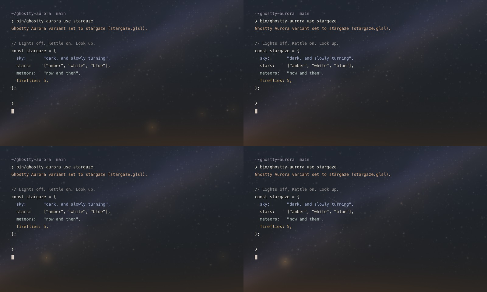

# Stargaze

Stargaze is an MIT-licensed Ghostty shader for when you want the terminal dark
and cozy. It leaves the background almost untouched and fills it with a night
sky: three depths of amber, white, and blue stars that twinkle slowly as the sky
turns, a dusty Milky Way with a dark rift, a meteor now and then, and a few
fireflies drifting in the warm glow of a hearth along the bottom edge. Stargaze
Lite keeps the stars and a softer hearth and drops the rest.



The bottom-right frame forces a meteor so it shows up in a still. Real ones
cross on fewer than half of the 19-second windows, at a random moment.

## Use

```sh
bin/ghostty-aurora use stargaze
bin/ghostty-aurora use stargaze-lite
bin/ghostty-aurora use stargaze --intensity 0.7
```

Include `config/ghostty-aurora.conf` in your Ghostty config, then reload the
config. Direct installation also works:

```conf
custom-shader = /absolute/path/to/stargaze.glsl
custom-shader-animation = true
```

## Tuning

Durable edits belong in `src/stargaze.template.glsl` and `src/variants.mjs`;
regenerate with `node scripts/build-variants.mjs`.

| Constant | What it does |
| --- | --- |
| `AURORA_INTENSITY` | Overall strength. Kept under this name so the switcher's `--intensity` and `intensity set` work. |
| `SKY_DRIFT` | Radians per second the sky turns around a pole above the window. |
| `MILKY_WAY` | Strength of the galaxy band. `0.0` removes it and its noise cost. |
| `SHOOTING_CHANCE` | Chance that a meteor crosses in each 19-second window. `0.0` disables meteors. |
| `FIREFLIES` | Number of fireflies. `0` removes the loop. |
| `HEARTH` | Strength of the warm glow along the bottom edge. |

## How it works

- Each star layer hashes its grid cell once. A star sits away from the cell
  edges, so one lookup never clips it. Brightness follows a cubic curve, so most
  stars are faint and a few are bright. The brightest stars in the nearest layer
  get thin cross glints.
- The sky turns around a pole above the window. Nearer layers turn slightly
  faster for a hint of parallax.
- The Milky Way is a gaussian band textured with two value-noise lookups and a
  third noise term for the dark rift. Faint stars crowd more densely inside it.
- Each meteor is a gaussian line with a fading tail, launched from one hash per
  19-second window.
- A highlight knee leaves faint light untouched but rolls bright star and
  firefly cores off smoothly, so no point turns pure white and reads as a stray
  glyph.
- Text protection, alpha handling, sub-LSB dither, and exact identity at zero
  intensity match Silk and Nocturne.

## Performance and validation

Measured on Apple M1 Pro, offscreen OpenGL via ModernGL, 45 warmup frames
and 180 measured frames per case, with Silk measured in the same run. This is a
shader microbenchmark, **not native Ghostty FPS**, nor a measure of Ghostty's
Metal pipeline, compositor, or battery cost.

| Shader | Resolution | Median | 95th percentile |
| --- | --- | --- | --- |
| Stargaze | 1920 × 1080 | 1.260 ms | 2.157 ms |
| Stargaze Lite | 1920 × 1080 | 0.743 ms | 1.725 ms |
| Silk (same run) | 1920 × 1080 | 0.858 ms | 1.871 ms |
| Stargaze | 3840 × 2160 | 4.534 ms | 5.140 ms |
| Stargaze Lite | 3840 × 2160 | 1.979 ms | 2.653 ms |
| Silk (same run) | 3840 × 2160 | 2.386 ms | 2.911 ms |

Raw data: `demo/stargaze/performance.json`. On large 4K windows, or if you care
about battery, prefer `stargaze-lite`.

`python scripts/verify-silk.py` covers both Stargaze variants. Its motion check
counts the share of pixels that change by at least two levels, rather than
averaging over the whole frame, because twinkling stars move only a small part
of it. Regenerate the stills and benchmark with:

```sh
python scripts/render-stargaze.py
python scripts/render-stargaze.py --benchmark
```
